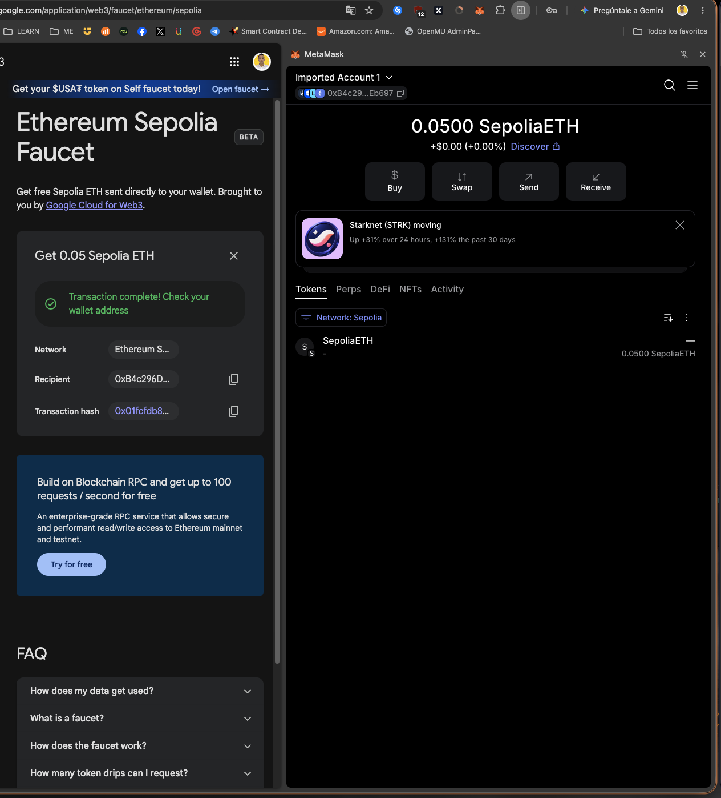
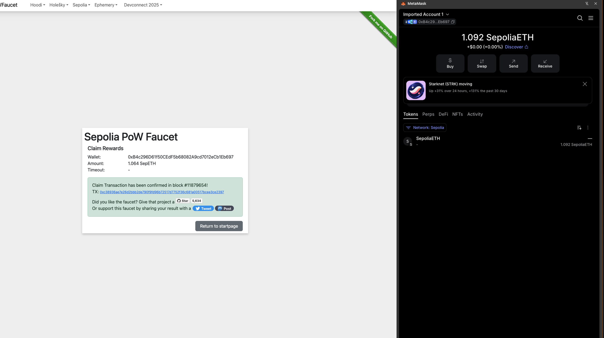
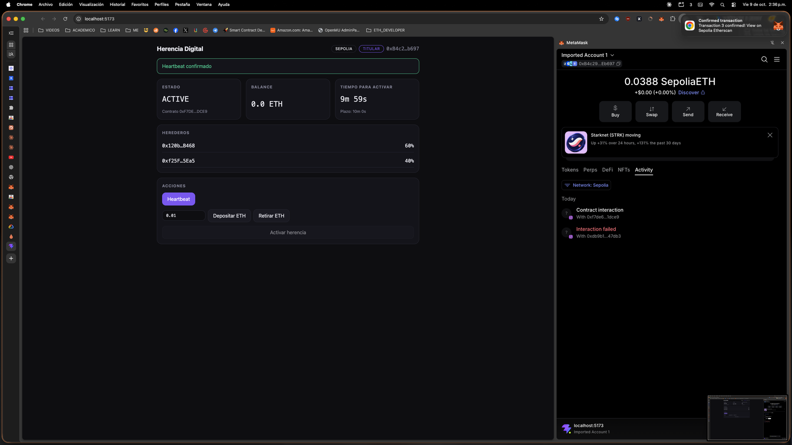
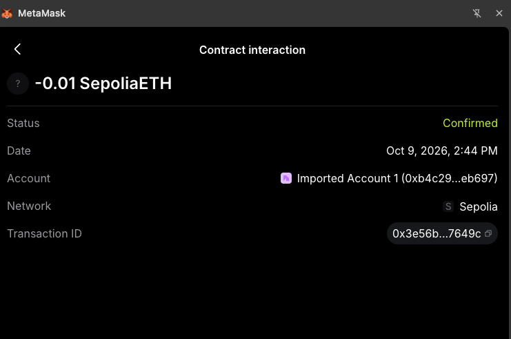
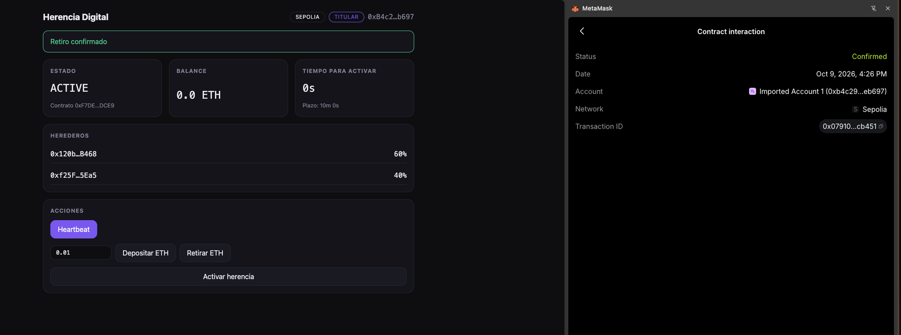
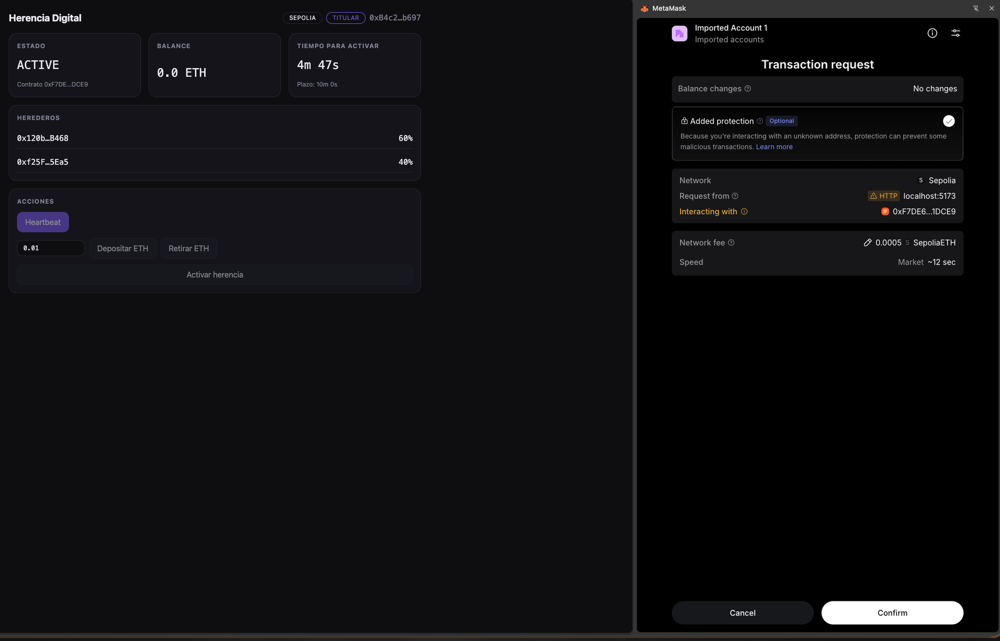
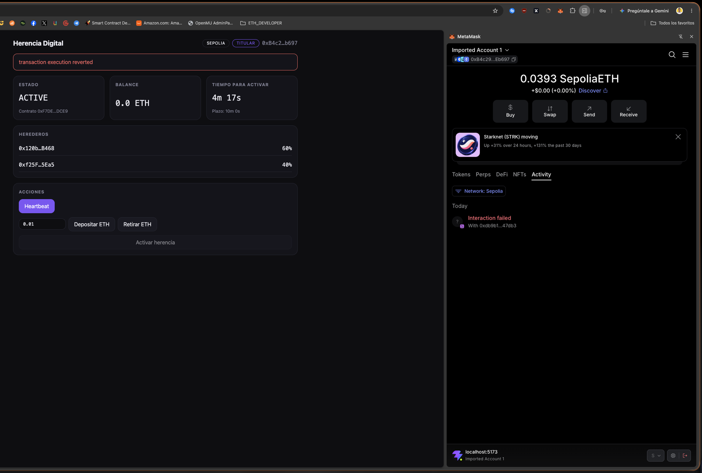
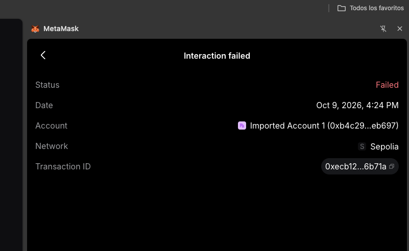

# front-herencia-digital

Frontend mínimo (React + Vite + ethers v6) para el contrato `DigitalInheritance`.

Repo del backend (contratos): https://github.com/MaximoBaronee/herencia-digital

## 🚀 Puesta en marcha

> 💡 **Esto es lo único que se "enciende".** Los contratos ya viven en Sepolia, así que no necesitas levantar ningún servidor de contratos:
> - `DigitalInheritance`: [`0xe45DB9f8f759Ad34C88C22c07BC4f09a274aa6a0`](https://sepolia.etherscan.io/address/0xe45DB9f8f759Ad34C88C22c07BC4f09a274aa6a0#code)
> - `InheritanceWatcher`: [`0x68E5FE129B3f51e79bdCfa6eabe7019962b93422`](https://sepolia.etherscan.io/address/0x68E5FE129B3f51e79bdCfa6eabe7019962b93422#code). El botón **Activar herencia** pasa por este contrato, que llama a la herencia (interacción entre contratos).

### 🆕 Primera vez (recién clonado)

```bash
git clone https://github.com/johanriascos7777/front-herencia-digital.git
cd front-herencia-digital
cp .env.example .env.local     # 1️⃣ configuración (ver tabla)
npm install                    # 2️⃣ requiere Node.js 18+
npm run dev                    # 3️⃣ abre http://localhost:5173
```

Contenido de `.env.local` para Sepolia:

```
VITE_CONTRACT_ADDRESS=0xe45DB9f8f759Ad34C88C22c07BC4f09a274aa6a0
VITE_WATCHER_ADDRESS=0x68E5FE129B3f51e79bdCfa6eabe7019962b93422
VITE_CHAIN_ID=11155111
VITE_CHAIN_NAME=Sepolia
VITE_RPC_URL=https://ethereum-sepolia-rpc.publicnode.com
VITE_DEPLOY_BLOCK=11941804
```

`VITE_WATCHER_ADDRESS` es obligatoria para el botón **Activar herencia**. `VITE_DEPLOY_BLOCK` es el bloque del deploy: desde ahí se lee la tarjeta **Historial**, que lista cada movimiento del contrato con su link a Etherscan.

| Pregunta | Respuesta |
|---|---|
| ¿Tengo que compilar el contrato? | ❌ No. El ABI ya viene en `src/abi/DigitalInheritance.json`. |
| ¿Necesito el repo del back? | ❌ No para usar el front. ✅ Solo si cambias el contrato. |
| ¿Qué necesito en el navegador? | 🦊 MetaMask con la red **Sepolia** y una cuenta con algo de Sepolia ETH. |
| ¿Cómo entro como titular? | Importa en MetaMask la cuenta que desplegó el contrato. El front detecta el rol solo. |

### 🔁 Segunda vez en adelante

| Situación | Qué hacer |
|---|---|
| Solo quiero abrir la app | `npm run dev` y abrir `localhost:5173` |
| Hice `git pull` y cambió `package.json` | `npm install` |
| Cambié `.env.local` | Reiniciar `npm run dev` (Vite lee el `.env` al arrancar) |
| Desplegaron contratos nuevos | Cambiar `VITE_CONTRACT_ADDRESS`, `VITE_WATCHER_ADDRESS` y `VITE_DEPLOY_BLOCK` (están en `deployments/sepolia.json` del back) y reiniciar |
| Cambió el código del contrato (nuevo ABI) | Regenerar el ABI (ver abajo) |
| Quiero validar antes de entregar | `npm run lint` y `npm run build` |

Regenerar el ABI cuando los dos repos están en la misma carpeta:

```bash
node -e 'require("fs").writeFileSync("src/abi/DigitalInheritance.json", JSON.stringify(require("../herencia-digital/artifacts/contracts/DigitalInheritance.sol/DigitalInheritance.json").abi, null, 2) + "\n")'
```

**🚫 Qué NO hacer**
- No confirmes transacciones con **"Added protection"** activada en MetaMask: envuelve la llamada y se revierte. Desactívala antes de pulsar *Confirm* ([incidencia](#-incidencias)).
- No subas `.env.local` a git (ya está ignorado).
- No uses una cuenta con fondos reales: esto es una **testnet** de demostración.
- Si el rol aparece como *Observador*, estás con otra cuenta de MetaMask, no es un error del front.

### 🧠 ¿Cómo funciona?

Un **testamento automático**: el titular deja ETH en el contrato y confirma cada tanto que sigue activo. Si deja de hacerlo, los herederos cobran solos, sin notarios ni intermediarios.

```
 💰 deposit() ──► 💓 heartbeat() ──► ... silencio ... ──► ⏰ plazo vencido
                                                              │
                                  ┌───────────────────────────┘
                                  ▼
                       🚨 triggerInheritance()   (la ejecuta cualquiera)
                                  │
                ┌─────────────────┴──────────────────┐
                ▼                                    ▼
      ↩️ cancelTrigger()                    🎁 claim() de cada heredero
   (solo el titular, y solo si                (cada uno cobra su %,
    nadie cobró todavía)                       una sola vez)
```

| Rol | Quién es | Qué puede hacer |
|---|---|---|
| 👑 **Titular** | quien desplegó el contrato | `deposit`, `heartbeat`, `withdraw`, `setHeirs`, `setInactivityPeriod`, `cancelTrigger`, `sweepDust` |
| 👨‍👩‍👧 **Heredero** | direcciones con un % asignado | `claim()` cuando la herencia está activada |
| 👀 **Observador** | cualquier otra wallet | `triggerInheritance()` si el plazo venció, y leer el estado |

### 🎬 Ejemplo: el caso de Ana

> Ana (titular) deja **1 ETH** para sus hermanos **Bruno (60 %)** y **Carla (40 %)**, con un plazo de **30 días** de inactividad.

| Día | Qué pasa | Estado |
|:-:|---|:-:|
| 0 | Ana despliega el contrato y llama `deposit()` con 1 ETH | 🟢 ACTIVE |
| 10 | Ana llama `heartbeat()`: el reloj de 30 días **vuelve a empezar** | 🟢 ACTIVE |
| 40 | Ana no responde: pasaron más de 30 días desde su último heartbeat | 🟡 plazo vencido |
| 41 | Carla (o cualquiera) llama `triggerInheritance()`: el balance de 1 ETH queda congelado | 🔴 TRIGGERED |
| 41 | Bruno llama `claim()` y recibe **0.6 ETH** | 🔴 TRIGGERED |
| 42 | Carla llama `claim()` y recibe **0.4 ETH** | 🔴 TRIGGERED |

**¿Y si fue una falsa alarma?** Si Ana vuelve entre el día 41 y el momento en que alguien cobra, llama `cancelTrigger()` y todo regresa a 🟢 ACTIVE sin perder fondos. Pero **en cuanto un heredero cobra, ya no hay vuelta atrás**.

---

## Estructura

- `src/styles/tokens.css`: tokens de diseño (colores, espaciado, tipografía).
- `src/components/`: `Button`, `Card`, `Stat`, `Badge`, `HeirList`, `Actions`.
- `src/lib/inheritance.ts`: conexión de wallet, lectura del estado y detección de rol.
- `src/abi/DigitalInheritance.json`: ABI exportado de `herencia-digital`.

## Checklist de entrega

Repos del proyecto:

- **Backend (contratos):** https://github.com/MaximoBaronee/herencia-digital
- **Frontend (React):** https://github.com/johanriascos7777/front-herencia-digital

Este checklist es el mismo en ambos repos.

**Hecho**
- [x] Contrato `DigitalInheritance` con CEI, `ReentrancyGuard`, eventos y errores custom.
- [x] NatSpec completo en `/contracts`.
- [x] 43 tests unitarios en verde (incluye reentrancia).
- [x] Scripts `demo`, `demo:cancel` y `deploy` (este último con herederos y plazo por variables de entorno).
- [x] Frontend base: conexión de wallet, detección de rol, dashboard y acciones.

**Backend (`herencia-digital`)**
- [x] Fondear con Sepolia ETH la wallet de despliegue.
- [x] Desplegar en Sepolia con `npm run deploy -- --network sepolia`.
- [x] Verificar el contrato en Etherscan (requiere `ETHERSCAN_API_KEY`).
- [x] Anotar la dirección desplegada en este README.
- [x] Reemplazar en el Roadmap la app Android por el frontend web en React.

**Frontend (`front-herencia-digital`)**
- [ ] Probar el flujo completo con MetaMask contra `npx hardhat node`.
- [ ] Crear el sistema de diseño en Claude (Sistema de diseño → New design system → Using Claude Code) apuntando a este repo.
- [ ] Aplicar el diseño con el CSS mínimo necesario.
- [ ] Configurar Sepolia (`VITE_CHAIN_ID`, `VITE_CHAIN_NAME`, `VITE_CONTRACT_ADDRESS`) y probar contra el contrato desplegado.

**Entrega**
- [ ] Grabar el video de presentación y demo (máximo 5 minutos, incluyendo el frontend).
- [ ] Verificar que ambos READMEs expliquen cómo ejecutar y el Roadmap.
- [ ] Subir los cambios a ambos repos.

---

## 🧰 Plataformas y servicios utilizados

| # | Plataforma | Acción realizada | Evidencia |
|:-:|---|---|:-:|
| 1 | 🔗 [Google Cloud Web3 Faucet](https://cloud.google.com/application/web3/faucet/ethereum/sepolia) | 💸 Recepción de **0.05 ETH** de Sepolia en la wallet de despliegue `0xB4c296D61f50CEdF5b68082A9cd7012eCb1Eb697` ([tx](https://sepolia.etherscan.io/tx/0x01fcfdb8775f8b708b484f9e3be5da1e43bee2a0a55861e771cf11c9a74356dd)) | [Figura 1](#figura-1) |
| 2 | 🔗 [Sepolia PoW Faucet (pk910)](https://sepolia-faucet.pk910.de) | ⛏️ Minado en el navegador y reclamo de **1.064 ETH** adicionales para las pruebas ([tx](https://sepolia.etherscan.io/tx/0xc38936ae7e26d2bbb2de790f9fd96b72517d7752f36c681a00517bcee3ce2397)) | [Figura 2](#figura-2) |
| 3 | 🔗 [MetaMask](https://metamask.io) | 🦊 Importación de la cuenta de despliegue, red Sepolia y firma de todas las transacciones del front | Figuras 3 a 5 |
| 4 | 🔗 [Sepolia Etherscan](https://sepolia.etherscan.io/address/0xF7DE6Dd4dB383cDb0E3A40eb676c0a57F1A1DCE9) | 🚀 Despliegue y verificación del código de `DigitalInheritance` en `0xF7DE6Dd4dB383cDb0E3A40eb676c0a57F1A1DCE9` ([código verificado](https://sepolia.etherscan.io/address/0xF7DE6Dd4dB383cDb0E3A40eb676c0a57F1A1DCE9#code)) ([tx](https://sepolia.etherscan.io/tx/0x796b1f076a8e2e2faf9a8e7ca0fbfd7a0b5f250c1b9f2315f935b4869be3dce3)) | — |

<a id="figura-1"></a>

<p align="center">
  
  <br>
  <em>Figura 1. El faucet de Google Cloud confirma el envío y MetaMask muestra 0.0500 SepoliaETH en la cuenta importada.</em>
</p>

<a id="figura-2"></a>

<p align="center">
  
  <br>
  <em>Figura 2. El faucet PoW confirma el reclamo de 1.064 SepETH. El gas lo pagó el faucet, no la wallet.</em>
</p>

## ✅ Pruebas realizadas en Sepolia

Las tres escrituras del titular se ejecutaron desde el front, con MetaMask y **sin** "Added protection":

| # | Acción | Resultado | Evidencia |
|:-:|---|---|:-:|
| 1 | 💓 `heartbeat()` | Confirmada, 29.225 de gas, evento `Heartbeat`, reloj reiniciado a 10 min ([tx](https://sepolia.etherscan.io/tx/0x288b07f8886e9eb33915f560417c3fe5351efc604af5f7420351eedbd7e49110)) | [Figura 3](#figura-3) |
| 2 | 💰 `deposit()` de 0.01 ETH | Confirmada, balance del contrato en 0.01 ETH ([tx](https://sepolia.etherscan.io/tx/0x3e56b0dd0043031af0fecd8b1aa5bd0ebb49a9f9ea69478dddb99deda2d7649c)) | [Figura 4](#figura-4) |
| 3 | 🏧 `withdraw(0.01 ETH)` | Confirmada, 45.328 de gas, evento `Withdrawn`, contrato en 0.0 ETH ([tx](https://sepolia.etherscan.io/tx/0x0791058db883ab6d98b08af6c1e4e89c66a5723a75994f08583189f31a6cb451)) | [Figura 5](#figura-5) |

<a id="figura-3"></a>

<p align="center">
  
  <br>
  <em>Figura 3. Heartbeat confirmado: la cuenta regresiva vuelve a cerca de 10 minutos.</em>
</p>

<a id="figura-4"></a>

<p align="center">
  
  <br>
  <em>Figura 4. Depósito de 0.01 ETH confirmado en el contrato.</em>
</p>

<a id="figura-5"></a>

<p align="center">
  
  <br>
  <em>Figura 5. Retiro confirmado: el balance del contrato vuelve a 0.0 ETH.</em>
</p>

## 🐞 Incidencias

Las dos tuvieron la misma causa: la opción **Added protection** de MetaMask envuelve la llamada en una delegación y no llega directa al contrato.

### 1. Heartbeat revertido desde el front

Al pulsar **Heartbeat**, MetaMask mostró la solicitud con **Added protection** activada ([Figura 6](#figura-6)) y la transacción terminó en `transaction execution reverted` ([Figura 7](#figura-7)).

Datos verificados en la cadena ([tx](https://sepolia.etherscan.io/tx/0x5a655b0fbd8fae7c412f4e5318f37422c3a0c5e20bf447144f7ee05a562a952b)):

- No fue directa al contrato `0xF7DE6Dd4dB383cDb0E3A40eb676c0a57F1A1DCE9`: se envió a `0xdb9B1e94B5b69Df7e401DDbedE43491141047dB3` llamando a `redeemDelegations`.
- Terminó con `status 0` (revertida) y consumió 300.877 de gas.
- El heartbeat no se aplicó: la cuenta regresiva siguió corriendo.
- La cuenta quedó con código de delegación EIP-7702 (`0xef0100…`), una actualización a cuenta inteligente hecha por MetaMask.

Estado: **resuelta**. Al desactivar **Added protection**, el heartbeat va directo al contrato y se confirma ([Figura 3](#figura-3)).

<a id="figura-6"></a>

<p align="center">
  
  <br>
  <em>Figura 6. Solicitud de MetaMask para Heartbeat, con Added protection activada.</em>
</p>

<a id="figura-7"></a>

<p align="center">
  
  <br>
  <em>Figura 7. El front muestra el error y MetaMask registra la interacción como fallida.</em>
</p>

### 2. Retiro atascado y cancelado

El retiro volvió a salir con **Added protection** activada: se envió a `0xdb9B…7dB3` con `redeemDelegations` ([tx](https://sepolia.etherscan.io/tx/0x3c62242d5c62871b21f7cb8303329d8d2928d056175aa3ee7f3176f348043e41), nonce 5) y quedó pendiente sin llegar a minarse. Se canceló desde MetaMask.

Datos verificados en la cadena:

- La cancelación ([tx](https://sepolia.etherscan.io/tx/0xecb1247e7bca03e387e70c1cda592d657ea82c3557abc8a96bf1d5e0a7d6b71a)) es una transacción de 0 ETH a la propia wallet con el **mismo nonce 5**, minada con `status 1` en el bloque 11880024 y un costo de 0.0000248 ETH.
- La transacción original quedó descartada y ya no existe en la red.
- El retiro no se ejecutó: el contrato conservó sus 0.01 ETH.
- MetaMask muestra la interacción como **Failed** aunque la cancelación se minó con éxito en la cadena ([Figura 8](#figura-8)).

Estado: **resuelta**. Con la protección desactivada, el retiro se confirmó en el siguiente intento ([Figura 5](#figura-5)).

<a id="figura-8"></a>

<p align="center">
  
  <br>
  <em>Figura 8. MetaMask etiqueta como Failed la transacción cancelada; en la cadena la cancelación sí se minó.</em>
</p>
